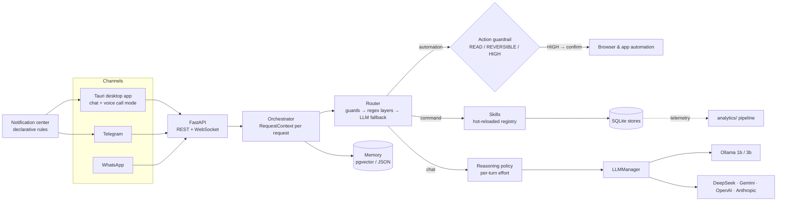

# Zephyro

A personal AI assistant I built and used daily: voice and chat in Rioplatense
Spanish, on the desktop (Tauri), Telegram and WhatsApp. It routes every message
across local and cloud models, runs skills (calendar, expenses, reminders, git,
system monitoring...), and automates the browser and desktop apps behind a
safety guardrail.

The project is finished. This repository is its final, documented state, and it
is organized as three pieces of work:

| | What | Where |
|---|---|---|
| 🧱 **Software engineering** | The assistant: FastAPI backend, multi-layer router, provider-agnostic LLM layer, skills, channels, and ~3,000 tests | [`backend/`](backend) · [`docs/adr/`](docs/adr) |
| 🛠️ **Data engineering** | Telemetry pipeline: incremental SQLite → Parquet → dbt/DuckDB, orchestrated by Dagster, with data-quality tests and synthetic data for CI | [`analytics/`](analytics) |
| 📊 **Data science** | Evaluation of the per-turn reasoning router: label reliability, holdout generalization, cluster bootstrap, McNemar, and the LLM judge's noise floor | [`research/reasoning_effort/`](research/reasoning_effort) |

## Architecture



## Engineering highlights

- **Safety by classification, not by hope.** Every automation is classed by "can the user
  lose work or control?", unknown actions fail closed, and `HIGH` actions always need a
  confirmation stored per session ([ADR 0004](docs/adr/0004-action-guardrail.md)).
- **Deterministic fast path.** Regex layers with conversational guards handle commands
  instantly. An LLM extractor is only a fallback ([ADR 0003](docs/adr/0003-regex-first-intent-extraction.md)).
- **Provider-agnostic LLM layer.** One model catalog, per-provider translation of thinking
  and effort settings, and streaming with fallbacks ([ADR 0001](docs/adr/0001-tiered-llm-routing.md)).
- **No shared mutable request state** across concurrent channels ([ADR 0002](docs/adr/0002-request-context.md)).
- **Notifications as data.** Typed rules, cooldowns and quiet hours, and deduplication that
  survives restarts ([ADR 0005](docs/adr/0005-declarative-notification-rules.md)).
- **Measured, reversible rollouts.** The reasoning policy ships in shadow mode behind one
  environment variable ([ADR 0006](docs/adr/0006-per-turn-reasoning-policy.md)).
- **Tests that can't take the machine down.** Each of the 195 test files runs in its own
  subprocess with a wall-clock timeout, so a hang loses one file, not the run.
  Tests that would drive a real browser are quarantined by default.

## Run the backend

```bash
cd backend
python -m venv venv && venv/Scripts/activate      # source venv/bin/activate on Linux/macOS
pip install -r requirements.txt
cp env.example .env                                # then fill in at least ADMIN_PASSWORD and one LLM key
python web_app.py                                  # http://localhost:8000
```

Local tiers need [Ollama](https://ollama.com) with `llama3.2:1b` and `llama3.2:3b`.
Without it, everything runs on the cloud provider you configure.

**Tests:**
- `python tests/_baseline_runner.py`: the full suite, isolated per file, with the browser tests quarantined.
- `python -m pytest tests/test_<area>.py`: a single area.

## Repository layout

```
backend/            FastAPI app, orchestrator, router, LLM layer, skills, channels, tests
src/, src-tauri/    desktop app (vanilla JS + Tauri)
analytics/          data engineering: Dagster + dbt telemetry pipeline
research/           data science: reasoning-router evaluation
docs/adr/           architecture decision records
```

## About this repository's history

This repository is a **clean snapshot**, not the original development repo. Zephyro
was built in a private repository over about seven months (168 commits on the main
line, from April 2026). That history contained personal data (conversation
summaries, local paths, contact identifiers) and was written while I used the
assistant day to day, so I published the final state with a fresh history instead of
rewriting the old one. The code, tests, ADRs, pipeline and study you see here are
exactly the finished project; only the commit log was reset.

The decision records in [`docs/adr/`](docs/adr) document the reasoning that the
commit log would otherwise show.
