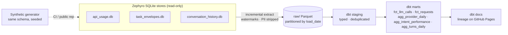

# Zephyro Analytics

A batch telemetry pipeline for **Zephyro**, my personal AI assistant. It answers the
questions an LLM product actually raises: *which model is slow, which one fails,
what does each kind of request cost, and is the logged spend even right?*

**Stack:** Dagster (orchestration) · dbt + DuckDB (transformation and tests) ·
Parquet landing zone · PyArrow · GitHub Actions.



## Run it

```bash
cd analytics
python -m venv .venv && .venv/Scripts/activate      # source .venv/bin/activate on Linux/macOS
pip install -e ".[dev]"
pytest -q                                            # extractor, PII and incremental tests
dagster dev                                          # UI on http://localhost:3000 → materialize all
```

The default source is **synthetic**: the repo runs end to end without any personal
data. `ZEPHYRO_ANALYTICS_SOURCE=real` reads Zephyro's own `storage/*.db` instead
(set a private `ZEPHYRO_ANALYTICS_SALT`). Each mode gets its own landing zone,
watermarks and warehouse, so the two never mix.

## Design decisions

| Decision | Why |
|---|---|
| **Incremental extraction with watermarks** | Only rows past the last watermark are read. `task_envelopes.started_at` is not unique, so its watermark also keeps the ids seen at that exact instant: a row written later with the same timestamp is neither lost nor re-read (tested). |
| **Watermarks move after the files are written** | A failed run re-extracts the same rows next time; staging deduplicates them. At-least-once loading + idempotent staging = effectively once. |
| **Append-only landing zone, dedup in staging** | Raw data is never rewritten, so any mart can be rebuilt from it. |
| **PII stripped at extraction, not in SQL** | Message text, titles, tool arguments and raw error messages never touch disk. Only their length is kept; user and session ids become salted SHA-256 hashes; errors become a coarse `error_type`, because messages can echo payloads or keys. |
| **Synthetic data with the real schema** | CI runs the *same* extractor that reads production data, not a mock. Generation is deterministic per day, and re-running only appends missing days. |
| **Sources opened read-only** (`mode=ro`) | The pipeline cannot write into the assistant's stores, even by mistake (tested). |
| **`fct_llm_calls` is incremental** | `delete+insert` on `call_id`, so only new calls are processed on each run. |
| **Latency percentiles over successful calls only** | A timeout's latency measures the timeout, not the model. |
| **No dbt packages** | Two small generic tests (`within_range`, `unique_combination`) instead of `dbt_utils`, so CI needs no `dbt deps` network step. |

## Data quality

`dbt build` runs **32 tests** in DAG order, so a failing staging test stops the marts
built on top of it. They cover keys, accepted values, referential integrity
(steps → requests), ranges, and four singular business checks:

- a failed call must cost nothing;
- a request cannot finish before it starts;
- *(warn)* every model must be in the price list;
- *(warn)* the logged cost must match the price list within 1%.

**What they caught on the real data:** the last two warned on day one.
- **DeepSeek spend was logged at ~23% of the list price.** The assistant's cost logger
  used an outdated price table, so it underestimated that provider about 4×.
- **Claude Haiku 4.5 was logged at ~80% of its price.**
- **A Gemini model had no price at all**, so its spend was invisible to every audit.

That is the point of declaring data quality in code: the bug was in the producer,
and the pipeline is what made it visible.

## CI

`.github/workflows/analytics.yml` on every change to `analytics/`:

1. Unit tests.
2. The full pipeline on synthetic data.
3. A **second run that must land zero new files**, which proves the extraction is incremental.
4. `dbt docs` (the lineage graph), deployed to GitHub Pages from `master`.

## Layout

```
analytics/
├── zephyro_analytics/
│   ├── config.py       # source mode, paths, salt
│   ├── extract.py      # incremental SQLite → Parquet, PII policy, watermarks
│   ├── synthetic.py    # seeded generator with Zephyro's schema
│   ├── assets.py       # Dagster assets: raw extract + dbt
│   └── definitions.py  # job, daily schedule, dbt resource
├── dbt/
│   ├── models/staging/ # typed + deduplicated views over the landing zone
│   ├── models/marts/   # facts and aggregates
│   ├── seeds/          # model_prices.csv
│   └── tests/          # singular business checks
└── tests/              # pytest for the Python side
```
