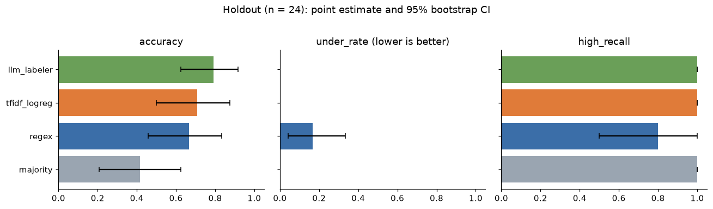
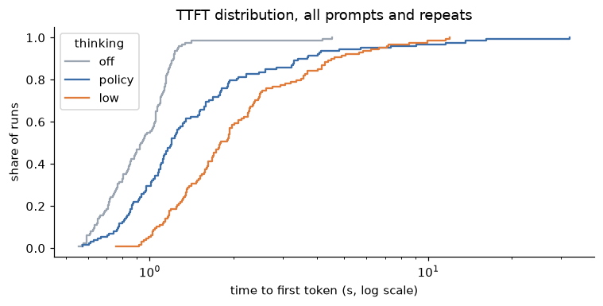

# When should an assistant think harder?

An evaluation of the per-turn **reasoning router** in Zephyro, my personal AI
assistant. For every message, a ~0.05 ms regex router
([`backend/core/reasoning_policy.py`](../../backend/core/reasoning_policy.py))
decides whether DeepSeek answers with its reasoning **on** (better on hard
problems, slower) or **off** (fast).

📓 **Full analysis:** [`notebooks/analysis.ipynb`](notebooks/analysis.ipynb), regenerated
from the saved runs by `python scripts/build_notebook.py` (no API calls).

## Findings

| | Result |
|---|---|
| **Label reliability** | A blind second annotator agrees with κ = 0.70 (linear-weighted), but 10 of its 17 disagreements are `medium` vs `high`: exactly the "think or not" boundary. |
| **Router generalization** | Perfect on the prompts it was designed on, and under-routes 2 of 10 hard prompts on a sealed holdout written by another model. |
| **Learned router** | TF-IDF + logistic regression is not detectably better at n = 24 (overlapping 95% CIs). |
| **Does thinking help?** | +3.2 pp verifiable accuracy, 95% CI [−3.2, +9.7] pp, McNemar p = 1.0: not distinguishable from zero. |
| **What it costs** | Always-on thinking doubles the median time to first token (0.93 s → 1.80 s). The router keeps the median at 1.20 s, but with a long tail (p90 3.5 s). |
| **LLM judge** | With two identical configurations the judge still returns 19% non-tie verdicts. That noise floor made my original "≤ 10% worse" acceptance criterion unattainable. |




## Method notes

- **Two splits.** Dev (40 prompts, mine) was used to write the rules, so any score on it is
  in-sample. Holdout (24 prompts) was written by Codex, a different model family,
  and sealed until the final test. The rules were not changed after it was opened.
- **Cluster bootstrap.** Each prompt ran twice per configuration. Every interval
  resamples prompts, never runs, because two runs of the same prompt are not independent.
- **Paired tests.** Configurations are compared on the same prompts, with an exact
  McNemar test on the discordant ones.
- **Asymmetric errors.** Next to accuracy I report the under-routing rate and the
  recall on `high`. A hard prompt answered without thinking costs a wrong answer,
  while an easy prompt answered with thinking only costs a second.
- **Negative controls.** The judge's noise floor is measured on prompts where the two
  compared configurations are literally the same.

## Mistakes I caught, and kept in the write-up

- **The holdout scorer read 0/12 on math for every configuration.** The holdout's
  patterns anchor the whole answer line, while my scorer only tested the value after
  the colon. A result that bad for every arm, thinking on included, was a measurement
  bug, not a model result.
- **The first kappa came out as 0.53.** `cohen_kappa_score(weights="linear")` without
  `labels=` orders the classes alphabetically (`high, low, medium`), which breaks the
  ordinal weights.
- **Two "failures" are correct answers with a unit** ("1000 pesos" where the pattern
  demands `1000`). A strict scorer is reproducible, and it also adds false failures.

## Reproduce

```bash
cd research
python -m venv .venv && .venv/Scripts/activate   # source .venv/bin/activate on Linux/macOS
pip install -r reasoning_effort/requirements.txt
python -m ipykernel install --user --name zephyro-research
cd reasoning_effort
pytest -q                                         # metric implementations
python scripts/build_notebook.py                  # rebuild the notebook and figures from data/runs
```

Collecting new runs needs a `DEEPSEEK_API_KEY` and costs a few cents:
`backend/tests/bench_reasoning_effort.py` produces `data/runs/*.json`, and
`scripts/label_with_llm.py` produces the second annotator's labels.

## Layout

```
reasoning_effort/
├── data/                  # dev + holdout prompts, blind labels, benchmark runs
├── reasoning_eval/        # loading, metrics (cluster bootstrap, McNemar), routers
├── scripts/               # notebook builder, second annotator
├── notebooks/             # the executed analysis
├── figures/
└── tests/
```
